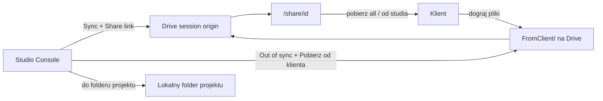

# Portal klienta MVP (dziś) + dogrywki + sync status

## Zakres

- **Tak:** portal na `/share/[id]` bez logowania/konta; pobieranie; dogrywanie nowych plików przez klienta; widoczność i pobranie w Console; znacznik sync / out-of-sync.
- **Nie (później):** konta klienta, rundy Delivery v2, komentarze/approve, mail automatyczny.

## Flow

## Konwencja folderów na Drive

W folderze sesji (origin):

- Istniejące pliki projektu (upload + sync studia) — bez zmian.
- **`FromClient/`** — wyłącznie dogrywki z portalu (nowe materiały klienta po share).
- Manifest `_team_manifest.json` — statusy Original / New / Modified jak dziś (dogrywki w `FromClient/` zawsze traktowane jako osobna kategoria **Od klienta**, nie mylone z „Od studia”).

## Portal klienta (`/share/[id]`)

Rozszerzenie [`SharePage.js`](drive-uploader/src/components/SharePage.js) + API:

1. **Lista** — sekcje: Twoje pliki · Od studia · Od klienta (`FromClient/`).
2. **Pobieranie** — wszystko / od studia / od klienta (ZIP jak dziś).
3. **Dograj pliki** — dropzone + ten sam wzorzec resumable co upload (`upload-session`), ale auth **share id** (nie upload token), target **tylko** `FromClient/` (tworzony przy pierwszym dropie). Guard: `isSessionFolder` + ścieżka pod share `folderId` + prefix `FromClient`.
4. Brak konta — dostęp = znajomość share linku (jak dziś); revoke w Console odcina listę, download i upload.

Nowe/zmienione API Vercel:

- `POST /api/share/[id]/upload-session` — init resumable do `FromClient/`.
- Ewentualnie `POST /api/share/[id]/ensure-from-client` — utwórz folder.
- Istniejące list/download — oznaczanie plików z `FromClient/` jako `fromClient`.

## Studio Console — sync status + dogrywki

W [`studio-pull/ui/app.js`](drive-uploader/studio-pull/ui/app.js) + [`ui-server.mjs`](drive-uploader/studio-pull/ui-server.mjs):

### Znacznik sync

Na wierszu sesji (już jest `lastSyncedAt` w bindingu):

- **Zsynchronizowano:** `12:05` (z `project-bindings.json`).
- **Out of sync** (alert wizualny), gdy po `lastSyncedAt` wykryto na Drive:
  - nowe/zmienione pliki poza pomijanymi `_uploader_*` / `_team_manifest`, **lub**
  - dowolne pliki w `FromClient/` nowsze niż `lastSyncedAt` / nieobecne lokalnie w `localPath/FromClient/`.

Endpoint: `GET /api/sessions` wzbogacony o `syncStatus: 'ok' | 'out_of_sync'`, `remoteChangedAt`, `fromClientCount` (lekkie porównanie: listing Drive + binding, bez pełnego hasha).

### Pobierz od klienta

Przycisk **Pobierz od klienta** (gdy `fromClientCount > 0` lub out_of_sync z FromClient):

- Pull tylko drzewa `FromClient/` → `localPath/FromClient/` (ten sam binding co projekt).
- Po udanym pullu: zaktualizuj znacznik lokalny dogrywek (osobne `lastClientPullAt` w bindingu); jeśli nie ma innych różnic vs origin, zejdź z alertu out_of_sync albo zostaw out_of_sync gdy studio jeszcze nie zsynkowało swoich edycji w drugą stronę.

Reguła alertu (prosta, MVP):

- `out_of_sync` = Drive ma pliki (w tym FromClient) z `modifiedTime > lastSyncedAt` **lub** lokalnie brakuje ścieżek z FromClient.
- Po **Sync → Drive** ustaw `lastSyncedAt = now`.
- Po **Pobierz od klienta** ustaw `lastClientPullAt = now`; out_of_sync znika, jeśli nie ma już nowszych remote poza tym, co lokal ma.

## Auth i bezpieczeństwo

- Share id = sekret URL (jak dziś).
- Upload z portalu: tylko do `FromClient/` pod `folderId` ze share; revoke → 404 na list/upload/download.
- Console: localhost OAuth jak dziś; bez zmian w tokenach uploadu klienta (`?token=` zostaje do pierwotnego wrzucenia projektu).

## Kolejność wdrożenia

1. Tagowanie `FromClient/` w list/share + UI sekcji „Od klienta”.
2. Upload dogrywek na share (API + dropzone).
3. Console: `syncStatus` / out_of_sync na liście sesji.
4. Console: **Pobierz od klienta** → lokalny `FromClient/`.
5. Dopięcie tekstów PL + krótki hint w Console.

## Pliki kluczowe

- [`src/components/SharePage.js`](drive-uploader/src/components/SharePage.js)
- [`src/lib/shareStore.js`](drive-uploader/src/lib/shareStore.js)
- Nowe: `src/app/api/share/[id]/upload-session/route.js`
- [`studio-pull/ui-server.mjs`](drive-uploader/studio-pull/ui-server.mjs) — sync status, pull FromClient
- [`studio-pull/lib/projectBindings.mjs`](drive-uploader/studio-pull/lib/projectBindings.mjs) — `lastClientPullAt`
- [`studio-pull/ui/app.js`](drive-uploader/studio-pull/ui/app.js) — badge + przycisk

## Weryfikacja

1. Share → widać sekcje; dograj 2 pliki → lądują w `FromClient/`.
2. Console: sesja **Out of sync**, widać liczbę dogrywek.
3. **Pobierz od klienta** → pliki w `…/projekt/FromClient/`.
4. Sync studia → znacznik „Zsynchronizowano” aktualny; po nowej dogrywce znowu out of sync.
5. Revoke share → portal i dogrywanie martwe; token uploadu `?token=` bez zmian.
