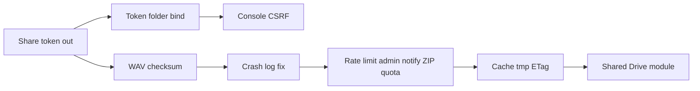

# Plan: remedacja audytu bezpieczeństwa (2026-11-15)

Źródło: [`../audyt-bezpieczenstwa.md`](../audyt-bezpieczenstwa.md)  
Żywy skrót produkcji: [`../../bezpieczenstwo.md`](../../bezpieczenstwo.md).

## Werdykt (bez kodu)

Audyt jest **trafny i aktualny**. Najważniejsze potwierdzenia w kodzie:

| Znalezisko | Ocena |
|---|---|
| `GET /api/share/[id]` zwraca `token` | **Potwierdzone** — krytyczny wyciek upload tokenu przez sam share link |
| Upload API: token dowolny + `isSessionFolder(folderId)` bez wiązania z właścicielem | **Potwierdzone** — IDOR między klientami |
| `ui-server` na `:8787` bez Origin/auth | **Potwierdzone** — CSRF / DNS rebinding lokalnie |
| Rate limit z surowego `X-Forwarded-For` | **Potwierdzone** |
| Admin cookie = stały HMAC(`admin-session-v1`) | **Potwierdzone** — logout nie unieważnia |
| ZIP w RAM (`JSZip`) | **Potwierdzone** — zbieżne z Post-MVP P0 plik-po-pliku |
| Detekcja zmian tylko po `size` | **Potwierdzone** — krytyczne dla WAV |
| Crash log po `ref = null` | **Wiarygodne** — do naprawy kolejności |
| God objects / duplikacja src vs studio-pull | **Słuszne**, ale **nie blokują** P0 bezpieczeństwa |

**Nie mylić z „nic nie jest zabezpieczone”:** token auth, `drive.file`, admin password, share-gated FromClient, noindex — z IX nadal działają. Audyt wskazuje **luki w nowej powierzchni** (share + Console + powiązania sesji).

## Poza zakresem pierwszego sprintu (świadomie)

- Magic-bytes / pełna analiza MIME (zostaje blocklista rozszerzeń)  
- Pełna migracja tokenów/progress na Postgres (poza zakresem; progress = Drive+ETag)  

- Rozbicie `globals.css` / rewrite Tauri UI  
- Konta klienta / OTP (VULN-08 nadal accepted)

Overlap: **P1 download** = ten sam kierunek co [`post-mvp_roadmap`](./post-mvp_roadmap_05ad683d.plan.md) P0 plik-po-pliku — wdrażać **raz**, nie dwa razy.

---

## P0 — Natychmiast (bezpieczeństwo + integralność WAV)

1. **Usunąć `token` z odpowiedzi share** — [`share/[id]/route.js`](../../src/app/api/share/[id]/route.js); publiczny portal dostaje tylko `label`, statusy plików, id share.  
2. **Wiązanie token ↔ folder** — przy `create-folder` zapisać właściciela (token) w metadanych sesji / manifeście / mapie; `upload-session`, `check-folder`, `build-structure`, `upload-progress`, `upload-log` odrzucają `folderId` nie należący do tego tokena.  
3. **Studio Console** — losowy token startowy (plik lokalny / env), wymagany nagłówek na `/api/*`; allowlist `Origin`/`Host` (`http://127.0.0.1:8787`, `tauri://…`); Tauri: nie ładuj UI jeśli port zajmuje proces spoza sidecara (PID / fingerprint).  
4. **md5Checksum / modifiedTime** w sync + statusach share (obok size) — [`syncDelta.mjs`](../../studio-pull/lib/syncDelta.mjs), [`shareStore.js`](../../src/lib/shareStore.js).  
5. **Crash log** — w `useUploadRunner` zachować `folderId`/`sessionId` w lokalnych zmiennych przed `ref = null`, potem wywołać `/api/upload-log`.

**Kryterium P0:** share link nie ujawnia upload tokenu; obcy token nie pisze do cudzego `folderId`; Console nie przyjmuje CSRF z obcej strony; zmodyfikowany WAV o tym samym size jest `modified` i syncowany.

---

## P1 — Stabilność nadużyć i zasobów

1. **Rate limit** — IP ze zaufanego łańcucha Vercel (`x-vercel-forwarded-for` / platform helper), nie pierwszy dowolny `X-Forwarded-For`.  
2. **Admin session** — losowy `sessionId` + HMAC + `exp`; store unieważnionych / wersja sekretu; logout unieważnia.  
3. **notify** — escape `uploaderEmail`; `isSessionFolder(folderId)`; retainer bez `prefillEmail` = świadoma polityka (udokumentować) albo wymusić prefill.  
4. **Pobieranie** — domyślnie plik-po-pliku do folderu (Post-MVP); ZIP tylko poniżej progu (np. &lt; 500 MB / &lt; N plików) lub jawny fallback.  
5. **Share upload quota** — limit plików/bajtów na share / dzień (nawet twarde stałe w env).

---

## P2 — Higiena i spójność stanu

1. `.gitignore` dla `.tmp*`; wyczyścić lokalne `.tmp-inventory.json` / `.tmp-missing.json` z repo jeśli są śledzone.  
2. Cache Drive: TTL + max entries; przy błędzie API **nie** zwracać „true” z samego faktu starego cache.  
3. Abort/`request.signal` na streamie share file.  
4. Progress: zapis Drive z `If-Match` / ETag (bez Redis/KV Marketplace).

---

## P3 — Architektura (po P0/P1)

- Wspólny pakiet operacji Drive (`src` + `studio-pull`)  
- Rozbicie `ui-server.mjs` / `app.js` na routery  
- Stopniowy podział CSS (upload / admin / share)

Nie mieszać z P0 — ryzyko regresji sync/share.

---

## Kolejność wdrożenia (rekomendowana)

1. P0a–P0e (możliwie jeden PR bezpieczeństwa + osobny PR WAV/sync)  
2. P1 (w tym download z Post-MVP)  
3. P2 / P3 według obciążenia

## Dokumentacja po wdrożeniu

- Zaktualizować [`bezpieczenstwo.md`](../../bezpieczenstwo.md) o nowe pozycje (share token, IDOR, Console, XFF, admin session, WAV).  
- Audyt zostawić jako źródło; nie przenosić do archiwum aż P0 zamknięte.
