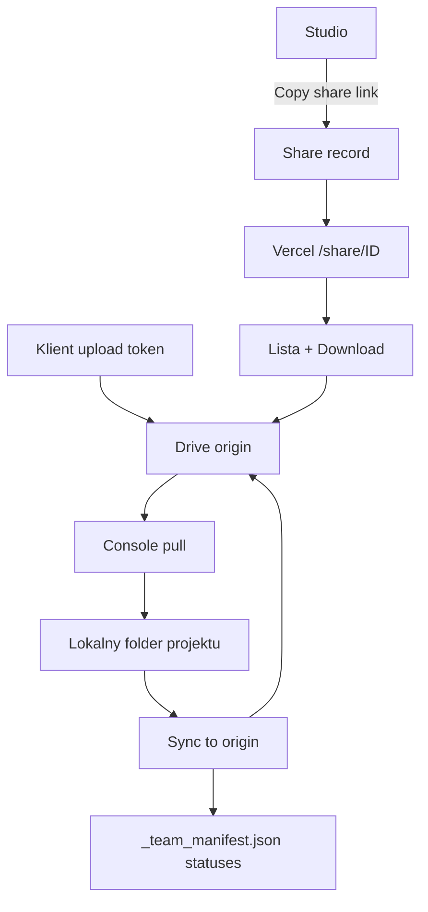

# Team Project — sync origin + kontrolowany share dla klienta

## Cel

1. Lokalny folder projektu (wskazany przy pullu) syncuje się **local → Drive origin**.
2. Klient **nie** ma automatycznego dostępu przez sam upload token.
3. Dostęp dostaje **tylko gdy Ty wyślesz mu share link** z Console.
4. Na stronie Vercel widzi listę: pliki które wysłał, nowe od Ciebie, zmodyfikowane — i może pobrać **wszystko** albo **tylko nowe + zmodyfikowane**, z zachowaniem struktury katalogów.

## Przykład

1. `CiaranCarty` uploaduje **SligoCancerCentre**.
2. Pull do `/Volumes/.../SligoCancerCentre` → binding.
3. Edycja lokalna → **Sync → Drive** (origin + aktualizacja manifestu statusów).
4. Ty klikasz **Copy share link** / wysyłasz link klientowi.
5. Klient otwiera link → lista (original / new / modified) → Download all **lub** Download new & modified (ZIP ze ścieżkami).



## Założenia

1. Sync → **ten sam origin** sesji (bez `Deliverables/`).
2. Binding: `folderId + token ↔ localPath` po pullu.
3. **Upload token ≠ dostęp do pobierania.** Osobny **share link** tworzony świadomie w Console.
4. Klasyfikacja plików względem baseline z momentu pulla / pierwszego syncu po pullu:
   - `original` — bez zmian względem baseline klienta
   - `modified` — ta sama ścieżka względna, inny size (lub hash)
   - `new` — ścieżka nieistniejąca w baseline
5. Pobranie: ZIP z relative paths (`folder/sub/clip.mp4`), tryby `all` | `delta` (new+modified).
6. Sync i share — ręczne przyciski w Console (v1).

## Model danych

### Binding lokalny (Console)

`~/Library/Application Support/StudioConsole/project-bindings.json` — jak wcześniej (`folderId`, `token`, `localPath`, `label`, `lastSyncedAt`).

### Manifest na Drive (w folderze origin)

`_team_manifest.json` (pomijany przy pullu jak inne `_uploader_*`):

```json
{
  "folderId": "...",
  "token": "CiaranCarty",
  "baselineAt": "ISO",
  "files": {
    "Clips/a.mp4": { "size": 123, "status": "original" },
    "Clips/b.mp4": { "size": 456, "status": "modified" },
    "Exports/cut.mp4": { "size": 789, "status": "new" }
  }
}
```

- Baseline: snapshot path→size przy pullu (lub przed pierwszym syncem).
- Po każdym Sync: przelicz statusy względem baseline; baseline **nie** resetuje się przy syncu (żeby „modified” zostawało widoczne dla klienta). Reset baseline = osobna akcja poza v1.

### Share records (Drive root)

`_uploader_shares.json`:

```json
{
  "shares": [
    {
      "id": "shr_…",
      "folderId": "…",
      "token": "CiaranCarty",
      "label": "SligoCancerCentre",
      "createdAt": "ISO",
      "revoked": false
    }
  ]
}
```

- Link: `https://…vercel.app/share/<id>` (bez upload tokenu w URL).
- Tworzenie / revoke tylko z Console (OAuth lokalny zapisuje do Drive).
- Sam `?token=CiaranCarty` **nie** otwiera listy plików team.

## Implementacja

### A–B. Binding + Sync (bez zmian intencji)

Jak w poprzedniej wersji planu: `projectBindings.mjs`, `syncDelta.mjs`, `upload.mjs`, `POST /api/sync` + SSE. Po syncu update `_team_manifest.json`.

### C. Share link (Console)

- Przycisk **Copy share link** przy projekcie z bindingiem (po co najmniej jednym syncu lub od razu — v1: wymaga syncu, żeby manifest istniał).
- `POST /api/shares` lokalnie → dopisz do `_uploader_shares.json`, zwróć URL.
- **Revoke share** — `revoked: true`.
- UI pokazuje status: brak share / aktywny link / revoked.

### D. Portal klienta (`/share/[id]`)

Vercel:

- `GET /api/share/[id]` — walidacja share (nie revoked, folder istnieje) → lista plików z manifestu + bieżące size z Drive; pola: `path`, `size`, `status` (`original`|`new`|`modified`).
- `POST /api/share/[id]/download` — body `{ mode: "all" | "delta" }` → budowa ZIP (struktura katalogów) ze streamem / temporary URL. Na Vercel limity czasu/rozmiaru: dla dużych paczek **zip po stronie job + link do pojedynczych plików jako fallback**; v1 preferuje **lista + checkboxy + „Download selected”** oraz skróty **All** / **New & modified** (paczki jako zip jeśli mieszczą się w limicie; inaczej kolejka plików / multi-download).

**Decyzja v1 (konkretna):** strona share pokazuje drzewo/listę z badge statusu; dwa CTA:
1. **Download all** — zip całego drzewa (lub sekwencyjne pobieranie plików jeśli zip przekroczy limit platformy; implementacja startuje od zip-stream gdzie możliwe).
2. **Download new & modified** — to samo tylko dla `status !== original`.

Auth share: znajomość `id` w URL (= sekret wysłany przez Ciebie). Opcjonalnie później PIN / expiry.

UI upload (`/?token=`) **bez** sekcji Downloads — download tylko na `/share/...`.

## Kolejność

1. Binding po pullu + baseline snapshot do manifestu.
2. Sync → origin + update statusów w manifestcie.
3. Create/copy/revoke share link w Console.
4. Strona `/share/[id]` + list + download all / delta ze strukturą.
5. E2E SligoCancerCentre.

## Pliki kluczowe

- Console: [`studio-pull/ui-server.mjs`](drive-uploader/studio-pull/ui-server.mjs), `ui/app.js`, nowe `projectBindings.mjs`, `syncDelta.mjs`, `upload.mjs`, `shareOps.mjs`, `manifestOps.mjs`
- Vercel: `src/app/share/[id]/page.js`, `src/app/api/share/[id]/route.js`, `src/app/api/share/[id]/download/route.js`
- Skip pull: dodać `_team_manifest.json`, `_uploader_shares.json` do listy pomijanych w [`driveWalk.mjs`](drive-uploader/studio-pull/lib/driveWalk.mjs)

## Weryfikacja

1. Pull SligoCancerCentre → binding + baseline.
2. Edycja + nowy plik → Sync → manifest: original/modified/new.
3. Bez share linku: `/share/…` nie istnieje; `?token=` nie pokazuje downloadów.
4. Copy share link → klient widzi trzy kategorie na liście.
5. Download all vs Download new & modified — struktura katalogów zachowana; delta bez nietkniętych originali.
6. Revoke → strona share niedostępna.
7. Inny projekt / share — brak przecieku plików.

## Poza v1

- Dwukierunkowy sync, watch folder, kasowanie remote
- Expiry / PIN na share
- Reset baseline / kolejne „runde” delivery
- ACL Google Drive na email klienta
