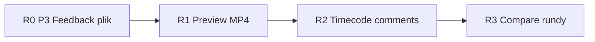

# Moduł Review — analiza i projekt wdrożenia (Frame.io-lite)

> Data: 2026-11-16 · **Bez kodu** — decyzje produktowe i architektura.  
> Kontekst: P0–P2 wdrożone (binding, plik-po-pliku, rundy, mail); następny krok roadmapy = **P3 feedback**.

---

## 1. Cel

Odpowiedzieć: czy i jak dodać moduł „jak Frame.io” do Drive Uploader / Studio Console / portalu share — **jako warstwę Review**, nie jako osobny produkt ani pełny klon.

**Sukces biznesowy:** klient ocenia dostawę w przeglądarce (status + opcjonalnie podgląd + komentarz przy klatce); studio widzi listę „do poprawy” w Console — bez Slacka / telefonu.

---

## 2. Czym jest Frame.io (mapa funkcji)

| Warstwa Frame.io | Opis | Priorytet dla Was |
|---|---|---|
| Share / guest review | Link bez pełnego konta | **Wysoki** — już macie share id |
| Version stack | Wersje ujęć / dostaw | **Wysoki** — rundy Draft/Final ≈ stack dostawy |
| Approve / Request changes | Status per asset | **Wysoki** — to P3 |
| In-browser player | Odtwarzanie + scrub | **Średni–wysoki** — rdzeń „feel” Frame.io |
| Timecode comments / pins | Komentarz przy TC | **Średni** — Frame.io-lite |
| Drawings / annotations | Rysowanie na klatce | Niski (v3+) |
| Proxy transcoder | Lekkie proxy do web | **Poza zakresem** (koszt / infra) |
| NLE plugins | Premiere, FCP, DaVinci | **Poza zakresem** (roadmapa już to wyklucza) |
| Multi-user accounts / orgs | Role, projekty, SSO | **Poza zakresem** (B2B share-link) |
| Live collab / presence | Wielu recenzentów naraz | Poza zakresem v1–v2 |

**Wniosek:** Frame.io = review + media pipeline + ecosystem. Wy potrzebujecie **review na Waszych rundach**, nie pipeline’u Adobe.

---

## 3. Co już macie (fit)

```
Upload (?token=) → Drive sesja → Console Sync → Opublikuj (runda)
                                              ↓
                                    /share/<id>  (lista, filtr od publikacji,
                                                  plik-po-pliku, FromClient)
                                              ↓
                                    mail prefillEmail
```

| Element produktu | Odpowiednik Frame.io | Luka |
|---|---|---|
| Rundy + snapshot | Version / delivery stack | Brak UI „compare versions” |
| Share link | Guest review URL | Brak playera i statusów approve |
| FromClient | Client upload back | Nie jest threadem komentarzy |
| Studio Console badge OOS | „Something needs attention” | Brak badge „feedback klienta” |
| P3 w planie | Approve / Changes | **Niezaimplementowane** |

Świadomie poza planem dziś (i powinno zostać poza Frame.io-lite): konta klienta, pełny player NLE, proxy wszystkich kodeków.

---

## 4. Werdykt możliwości

| Opcja | Ocena |
|---|---|
| A. Pełny klon Frame.io | **Nie** — infra proxy, pluginy, konta = inny produkt |
| B. Integracja z Frame.io API (hosting mediów u nich) | Możliwe, ale **podwaja** storage/auth i psuje model „wszystko na Drive” |
| C. **Moduł Review na share + rundach** | **Tak — rekomendowane** |

**Rekomendacja: opcja C**, fazami R0→R2 (R3 opcjonalnie). R0 = istniejące P3.

---

## 5. Projekt produktu (Frame.io-lite)

### Persona i job

- **Klient:** otwiera mail / share → widzi rundę → oznacza pliki / zostawia notatkę (później: ogląda MP4 i pinuje TC) → studio wie, co poprawić.  
- **Studio:** w Console przy sesji: „3 pliki Changes requested” → poprawki → nowy Draft / Final.

### Zasady UX (spójne z produktem)

- Nadal **jeden share link** — bez logowania klienta.  
- Review zawsze w kontekście **aktualnej rundy** (`roundId`).  
- FromClient zostaje dogrywką plików; **nie** mieszać z wątkiem komentarzy.  
- UI portalu: jedna sekcja „Review” / statusy na liście plików — bez dashboardu Frame.io.

### Stany pliku (R0)

`unreviewed` | `approved` | `changes_requested`  
+ opcjonalna notatka (krótki tekst).

### Markers (R2)

Na plikach wideo: `{ id, tSec, body, authorLabel?, createdAt }`  
Autor = „Klient” (z share) albo prefillName z tokenu jeśli znany po stronie share.token.

---

## 6. Architektura (koncept, bez kodu)

### Powierzchnia

```
Internet
  /share/<id>              → lista + (R0) statusy + (R1) player + (R2) markers
  /api/share/<id>/…        → GET lista; POST feedback (share id)
  Studio Console           → badge / lista „do poprawy” (czyta Drive JSON)
```

### Dane (Drive, jak reszta produktu)

Propozycja: **`_team_feedback.json`** w folderze sesji (obok `_team_manifest.json`).

```
{
  version: 1,
  updatedAt,
  byRound: {
    [roundId]: {
      [relativePath]: {
        status: "approved" | "changes_requested" | "unreviewed",
        note: "...",
        updatedAt,
        markers: [ { id, tSec, body, createdAt } ]   // od R2
      }
    }
  }
}
```

Alternatywa: pole w manifeście rundy — gorsze przy częstych zapisach feedbacku (konflikty z publish). **Osobny plik + ETag/If-Match** jak progress/tokeny.

### Auth / bezpieczeństwo

- Zapis feedbacku: **tylko share id** (jak list/download/FromClient) + rate limit.  
- Bez OTP (VULN-08 accepted) — ryzyko: kto ma link, może zmieniać statusy; revoke share = stop.  
- Preview stream: nie wystawiać raw Google access token do przeglądarki; tylko Wasz proxy/stream z walidacją `assertFileInShareFolder` + MIME allowlist.  
- Limit długości notatki / liczby markers per plik (abuse).

### Preview (R1) — ograniczenia

| Działa w przeglądarce | Nie działa bez proxy |
|---|---|
| MP4 H.264 + AAC | ProRes, DNx, BRAW, R3D, wiele MXF |
| WebM / część HEVC (zależnie od OS) | Kontenery „kamerowe” |

Polityka produktu: **preview tylko gdy MIME/whitelist OK**; inaczej CTA „Pobierz”. Nie obiecywać „wszystkie kodeki jak Frame.io”.

Pasmo: stream przez Vercel ma limity `maxDuration` / body — dla dużych plików rozważyć krótkie Range requests albo „otwórz w nowej karcie” z Controlled download URL; unikać składania całego pliku w RAM (lekcja ZIP).

### Console (studio)

- Przy sesji z aktywnym share: licznik `changes_requested` z `_team_feedback.json` dla `roundId`.  
- Lista ścieżek + notatka (read-only w Console v1).  
- Po nowym Opublikuj: feedback dotyczy **nowej** rundy (stara zostaje w `byRound` historycznie).

---

## 7. Fazy wdrożenia



| Faza | Zakres | Kryterium sukcesu | Zależności |
|---|---|---|---|
| **R0** | Approve / Changes / notatka; zapis Drive; badge Console | Studio widzi listę „do poprawy” bez Slacka | Rundy (P1) już są |
| **R1** | Player w portalu dla whitelisted MIME; scrub | Klient ogląda draft bez pełnego downloadu | R0 + stream Range |
| **R2** | Markers TC + lista obok playera | Komentarz „u 01:12:03” trafia do Console | R1 |
| **R3** | UI diff vs poprzednia runda (reuse `vsPrevRound`) | Klient filtruje „co nowe od Draft N-1” w trybie Review | R0 + istniejący diff |
| **RX** | Proxy farm, NLE plugins, rysowanie, konta | — | **Nie w roadmapie** |

**Kolejność obowiązkowa:** R0 przed R1 (statusy mają wartość bez playera; player bez statusów = tylko „ładniejszy download”).

---

## 8. Świadomie poza Frame.io-lite

- Transkodowanie proxy na serwerze / Cloud Run / MediaConvert  
- Pluginy Premiere / Final Cut / Resolve  
- Współdzielone konta, role, SSO  
- Live presence (kilku recenzentów naraz)  
- Drawing na klatce, waveform audio advanced  
- Porównywanie klatka-w-klatkę (A/B wipe) — dopiero po R3 jeśli w ogóle  

---

## 9. Ryzyka i mitygacje

| Ryzyko | Mitygacja |
|---|---|
| Oczekiwanie „jak Frame.io na ProRes” | Copy w UI: preview tylko MP4; reszta = pobierz |
| Koszt / timeout streamu Vercel | Range + limit rozmiaru preview; duże pliki → download |
| Race przy zapisie feedbacku | ETag If-Match na `_team_feedback.json` |
| Spam statusów przez wyciek linku | Rate limit; revoke share; krótka TTL share (opcjonalnie później) |
| Scope creep UI | R0 lista statusów; R1/R2 w jednym panelu pliku — bez nowego „app shell” |

---

## 10. Relacja do istniejącej dokumentacji

| Dokument | Rola |
|---|---|
| [`post-mvp_roadmap_….plan.md`](./post-mvp_roadmap_05ad683d.plan.md) | P3 = **R0** tego planu |
| [`produkt_i_backlog.md`](../produkt_i_backlog.md) | Backlog produktu — dodać odniesienie do Review |
| [`bezpieczenstwo.md`](../bezpieczenstwo.md) | Przy R0/R1 uzupełnić powierzchnię `POST feedback` / stream |
| [`operacje.md`](../operacje.md) | Po R0: procedura „klient oznaczył Changes” |

---

## 11. Rekomendowany start

1. **Zaimplementować P3 / R0** (Approve / Changes / notatka + Console badge) — domyka obecną roadmapę.  
2. Zmierzyć, czy klienci w ogóle oglądają w przeglądarce, czy tylko pobierają — dopiero wtedy **R1**.  
3. **R2** tylko jeśli studio realnie pracuje na TC z klientami (postprodukcja wideo); dla foto/docs R0 wystarczy.  
4. Nie planować RX (proxy/NLE) w tym produkcie.

**Jedno zdanie:** Frame.io-lite u Was = **review na rundach przez share link**, nie nowy hosting mediów.
