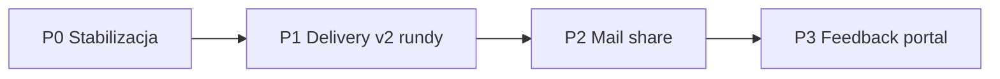

# Plan po wdrożeniu MVP (kolejne etapy)

## Punkt wyjścia

Działa: upload → pull → Sync → **Opublikuj (rundy)** → share (+ mail `prefillEmail`) → pobieranie plik-po-pliku / dogrywki + Out of sync + twardy binding. Brak: **P3 feedback** (Approve / Changes requested).

## Kolejność (wartość → koszt)

---

### P0 — Stabilizacja (najpierw, krótki sprint)

Cel: mniej pomyłek studia i mniej „wisi” przy pobieraniu.

1. **Twardy binding folderu projektu**
   - Sync wyłącznie z `localPath` zapisanym przy Pobierz.
   - Ostrzeżenie, gdy lokalne drzewo wygląda na zagnieżdżoną „sesja/sesja/…”.
   - Opcjonalny przycisk „Napraw wskazanie” (wskaż ponownie folder sesji).
   - Pliki: [`studio-pull/ui-server.mjs`](drive-uploader/studio-pull/ui-server.mjs), [`studio-pull/ui/app.js`](drive-uploader/studio-pull/ui/app.js), [`projectBindings.mjs`](drive-uploader/studio-pull/lib/projectBindings.mjs).

2. **Lżejsze pobieranie w portalu (domyślnie bez ZIP)**
   - **Default:** klient klika Pobierz → wybiera folder na dysku (`showDirectoryPicker` / File System Access API) → pliki lecą **jeden po drugim** z zachowaniem względnej struktury katalogów.
   - Pasek postępu: plik N/M, nazwa, % bieżącego pliku; skip gdy lokalny plik ma ten sam rozmiar.
   - **ZIP tylko jako zapas:** przeglądarki bez File System Access (Safari/Firefox) albo jawny przycisk „Pobierz jako ZIP”.
   - Zero składania całej paczki w RAM — koniec wrażenia „zawieszenia” przy dużych klipach.
   - Pliki: [`SharePage.js`](drive-uploader/src/components/SharePage.js).

3. **Czytelniejszy Out of sync**
   - Rozróżnij w UI: „dogrywki klienta” vs „zmiany na Drive od ostatniego Sync”.
   - Po „Pobierz od klienta” alert znika tylko dla części FromClient.

Poza P0: sprzątanie starych duplikatów na Drive (osobne narzędzie później).

---

### P1 — Delivery v2 (rundy) — główny produktowy krok

Cel: klient wie, **co jest nowe od ostatniego linku**.

**Model**
- Sync może być roboczy (nie dla klienta).
- **Opublikuj Draft N** w Console tworzy rundę: snapshot path→size (+ etykieta Draft 1 / 2 / Final).
- Share wskazuje **najnowszą opublikowaną rundę** (lub konkretną rundę w URL).
- Na portalu: „Od ostatniej publikacji” = diff vs poprzednia runda; „Całość od Twojego uploadu” = jak dziś vs baseline klienta.

**Dane**
- `_team_manifest.json`: `rounds: [{ id, label, publishedAt, snapshot }]`.
- `_uploader_shares.json`: `roundId` (domyślnie latest published).

**UI Console**
- Po Sync: **Opublikuj** (nie tylko „Wyślij link”).
- Lista rund przy sesji; Copy link = link do latest / wybranej rundy.

**UI Portal**
- Badge względem wybranej rundy; CTA „Pobierz od ostatniej publikacji” + „Pobierz wszystko”.

FromClient poza rundami studia (osobna sekcja dogrywek — bez zmian konceptu).

---

### P2 — Mail z share

Cel: jeden klik zamiast ręcznego kopiowania.

- Przy **Opublikuj** / **Wyślij link**: wyślij mail na `prefillEmail` z tokenu (nodemailer już w projekcie).
- Treść: nazwa projektu, numer rundy, URL share, krótka instrukcja.
- Console: potwierdzenie „wysłano / błąd SMTP”.

---

### P3 — Feedback w portalu (bez kont)

Cel: klient oznacza pliki, studio widzi status.

- Per plik (w kontekście rundy): Approve / Changes requested + krótka notatka.
- Zapis w Drive JSON przy sesji (np. `_team_feedback.json`) albo w manifeście rundy.
- Console: lista „do poprawy” przy sesji + badge.
- Bez kont / logowania — nadal sam share link.

---

## Świadomie poza planem

- Konta klienta / wiele projektów na jednym loginie
- Dwukierunkowy sync z konfliktami
- Auto-watch lokalnego folderu
- ACL Google Drive na email klienta
- Pełny player NLE / preview wszystkich kodeków

## Kryteria sukcesu

- P0: zero przypadkowych synców w zły folder; pobieranie = plik-po-pliku do wskazanego folderu (ZIP tylko fallback).
- P1: po Draft 2 klient pobiera tylko to, co nowe względem Draft 1.
- P2: Opublikuj → mail z linkiem bez ręcznego copy.
- P3: studio widzi listę plików „do poprawy” bez telefonu/ Slacka.

## Rekomendowany start wdrożenia

Zacząć od **P0**, potem od razu **P1 (rundy)** — to największy zysk przy kolejnych poprawkach projektu. P2/P3 po ustabilizowaniu rund.
